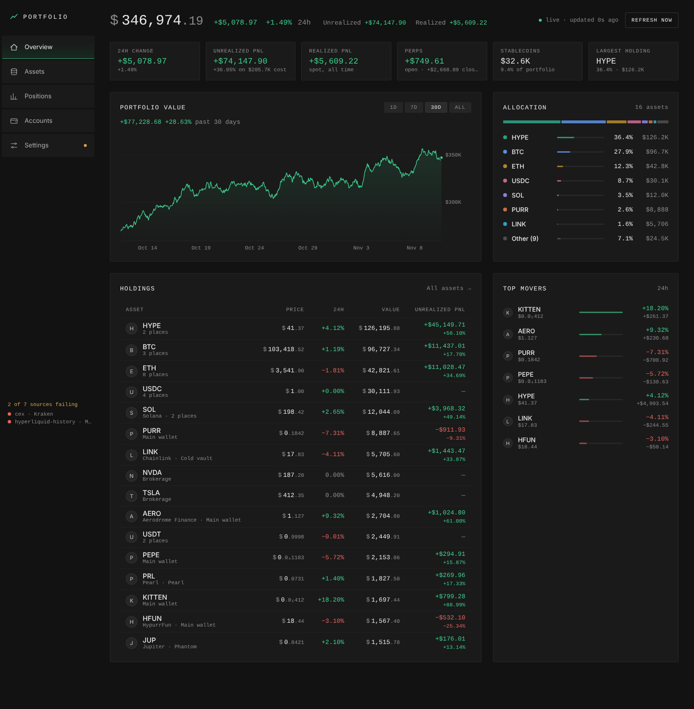

# Portfolio tracker

A local, read-only portfolio tracker: live balances and prices across EVM chains, Hyperliquid,
Solana, Pearl and centralised exchanges, with cost basis and full buy/sell history.



*Screenshot uses made-up demo data.*

- **Private by design.** One Node process and one SQLite file on your machine. No hosted backend,
  no telemetry, no external scripts or fonts. The server listens on `127.0.0.1` only.
- **Read-only.** It only ever needs public wallet addresses and read-only exchange keys. It cannot
  move funds and never asks for a private key or seed phrase.
- **Zero dependencies.** Needs Node 22.13 or newer and nothing else (`node:sqlite`, built-in `fetch`).
- **No manual token lists.** Tokens are discovered from what your wallets hold and priced by
  contract address. Spam airdrops are kept out of totals.

## Quick start

1. Install [Node.js](https://nodejs.org) 22.13 or newer (`node -v` to check).
2. Get the code and start it. There is nothing to `npm install`.

   ```sh
   git clone https://github.com/dancreee/portfolio-tracker-public.git portfolio-tracker
   cd portfolio-tracker
   npm start
   ```

3. Open <http://localhost:4321>.
4. Go to **Accounts** and choose **Add account**:
   - **EVM wallet**: paste a `0x…` address. The main chains are scanned automatically and the same
     address is checked on Hyperliquid (spot, staking, perps).
   - **Solana** or **Pearl wallet**: paste the address.
   - **Exchange** (Kraken or Binance): paste a **read-only** API key and secret. Create a key with
     query/read permissions only, with trading and withdrawals switched off.
   - **Manual**: holdings you type in yourself, such as a brokerage account.
5. Optional but recommended, under **Settings**:
   - **Blockscout API key** (free, from [dev.blockscout.com](https://dev.blockscout.com)). Some
     chain explorers refuse requests without one.
   - **Alchemy API key**. Only used as a fallback where Blockscout's free plan has no coverage
     (Base, for example), and throttled to keep usage low.
   - **Solana RPC URL**. The public RPC works but is slow and rate-limited.
   - **Other addresses you own**, such as old wallets, so transfers to and from them are treated
     as internal rather than as deposits and withdrawals.

Balances appear within a minute. Full history, and therefore cost basis, can take a few minutes on
the first run for wallets with many transactions.

`npm run dev` does the same as `npm start` but restarts when a source file changes.

## Where your data lives

Everything you enter, including exchange keys, is stored in `data/portfolio.db` next to the code and
nowhere else. `data/`, `.env` and `accounts.seed.json` are gitignored, so a fork or pull request
will not pick them up. Keys are stored unencrypted in that file, so protect it like any other
credential: use read-only keys, and do not sync the folder to a shared drive.

To start over, stop the app and delete the `data/` folder.

Your wallet addresses are sent to the services below in order to look up balances, the same as
opening a block explorer. Nothing else leaves your machine.

## What it reads

| Source | How | Key needed |
| --- | --- | --- |
| EVM wallets (Ethereum, Base, Arbitrum, Optimism, Robinhood Chain, Polygon, more) | Blockscout REST API, Alchemy as fallback | free Blockscout key recommended |
| Hyperliquid (spot, staking, perps, fills) | Hyperliquid info API, checked for every EVM wallet | no |
| Solana wallets | Solana JSON-RPC | no |
| Pearl wallets | Pearl explorer | no |
| Kraken, Binance | Exchange REST API | read-only API key |
| Prices | DefiLlama (live and historical), GeckoTerminal for long-tail tokens, Hyperliquid and exchange tickers | no |

Ethereum, Base, Arbitrum, Optimism and Robinhood Chain are scanned for every EVM wallet. Polygon,
Unichain, Gnosis, Scroll and zkSync can be switched on per account. Chains are defined in
`src/chains.js`.

## Cost basis

History is rebuilt from every transfer, swap and fill, then run through average cost per asset:

- **Swaps and fills** are buys/sells at the price actually paid (stablecoin side or fill price).
- **Transfers between your own accounts** keep their basis. They are recognised by address, or by a
  matching amount leaving one account and arriving in another within three days (bridges, exchange
  withdrawals). List old wallets under Settings so basis follows funds through them.
- **Deposits from elsewhere** enter at the market price at that time.
- **Withdrawals** remove holdings at average cost; **fees** are realised losses.
- Any line can be reclassified or re-priced by hand from the asset's history.

Figures are estimates for your own tracking, not tax or financial advice.

## Refresh rates

Prices every 15 s, Hyperliquid every 10 s, wallet balances every 60 s, history every 5 min.
A portfolio value snapshot is stored every 5 min for the chart.

## Configuration

All optional. Set these in the environment or in a `.env` file next to `package.json`.

| Variable | Default | Purpose |
| --- | --- | --- |
| `PORT` | `4321` | Port to listen on |
| `HOST` | `127.0.0.1` | Interface to bind to |
| `ALLOWED_HOSTS` | none | Extra hostnames the app may be browsed at, comma separated |
| `PORTFOLIO_DB` | `data/portfolio.db` | Path to the SQLite file |
| `BLOCKSCOUT_API_KEY`, `ALCHEMY_API_KEY` | none | Same as the keys in Settings, which take priority |

To pre-load accounts instead of typing them in, copy `accounts.seed.example.json` to
`accounts.seed.json` and edit it. It is imported once, on the first run with an empty database.

## Serving on a private network

Set `HOST` to the interface IP (for example your Tailscale IP) and `ALLOWED_HOSTS` to the hostnames
you browse to. **Do not expose the port to the public internet: there is no login.**

## Troubleshooting

- **`node:sqlite` errors or "bad option" on start**: Node is too old. Upgrade to 22.13 or newer.
- **A chain shows as failing**: add a Blockscout API key in Settings. The sidebar lists which
  sources are failing and why.
- **Cost basis shows as partly known**: history has not finished syncing, or funds came from a
  wallet the app does not know about. Add that wallet as an account or under "other addresses you own".
- **Exchange errors**: check the key is read-only and has permission to query balances, trades and
  ledger/deposit history.

## Tests

```sh
npm test
```

Tests run offline against fixtures. Any keys or addresses in `test/` are placeholders.

## Licence

MIT. See [LICENSE](LICENSE).
